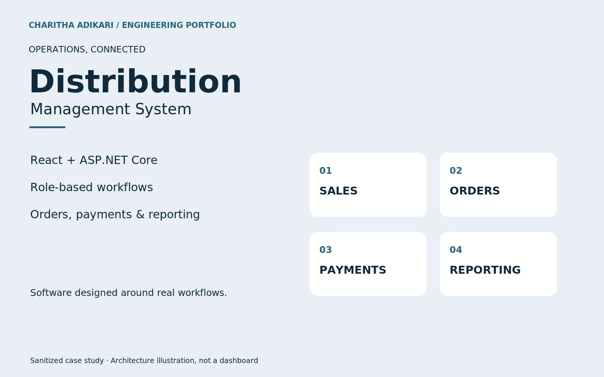

# Distribution Management System

Role-based sales operations connecting product catalogues, order approvals, payment records and outstanding-balance reporting.

## Engineering

A distribution business needs a consistent view of orders and money owed across different user roles. The React frontend communicates with ASP.NET Core APIs whose controllers enforce role-based access. Application services and Entity Framework Core support the backend data layer. Verified flows include order approvals, product catalogue operations, payment recording and verification, customer balances and outstanding-report handling. This presentation shares architecture and permitted capabilities without redistributing client source or production data.

## Contribution

Developed React and .NET distribution workflows for orders, payments and reporting, as documented in my freelance experience.

## Technologies

React · TypeScript · ASP.NET Core · C# · Entity Framework Core · PostgreSQL

## Implemented capabilities

- Administrator, sales representative, coordinator and customer workflows
- Order creation, approval and status tracking
- Product and catalogue management
- Payment verification, customer balances and outstanding reports

Public case study. The visual is an architecture illustration, not a production dashboard. Client source and data remain private.

[Portfolio](https://charithaadikari.vercel.app/projects/101)
