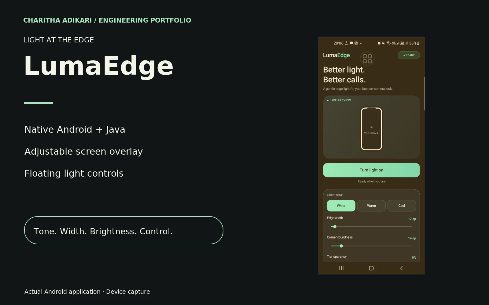

# LumaEdge

A native Android utility that places adjustable light around the screen edge with floating controls.

## Engineering

LumaEdge uses Android overlay windows to create a configurable border of light around the display. Its native Java implementation separates the main settings activity, overlay service and floating controls. Users can adjust light appearance and brightness while supported overlay behavior keeps the controls accessible outside the main activity. The app requests the relevant overlay and system-brightness permissions. Compatibility depends on Android and device restrictions; universal video-call compatibility is not claimed.

## Contribution

Developed the native Android interface, overlay service and floating light controls.

## Technologies

Java · Android SDK · WindowManager · Foreground Service

## Implemented capabilities

- Screen-edge overlay with rounded corners
- Adjustable light tone, width, transparency and brightness
- Floating controls for adjustment outside the main screen
- Brightness restoration when the light is switched off

Visual evidence: current Android application captured on a connected device. No call recording or personal data is shown.

[Portfolio](https://charithaadikari.vercel.app/projects/104)
