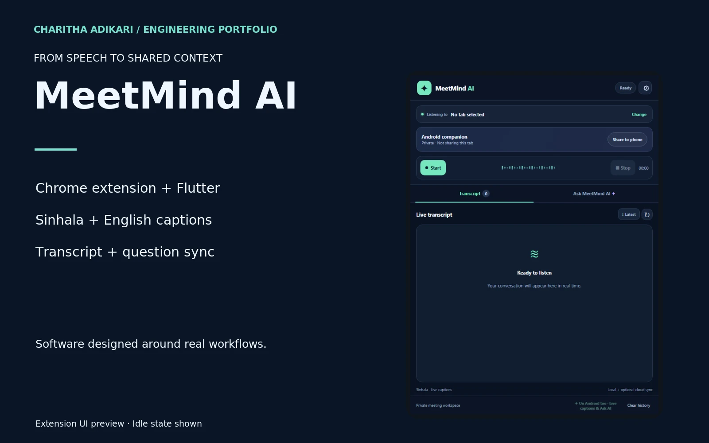

# MeetMind AI

A Chrome extension and Flutter Android companion for Sinhala and English captions, transcript workspaces and AI questions.

## Engineering

MeetMind AI connects browser audio and speech-recognition workflows with a compact transcript workspace. The extension uses Chrome side-panel and offscreen components, with Web Speech recognition for Sinhala and English. An authenticated Supabase synchronization layer shares transcript text and questions with the Flutter companion. The engineering focus is on handling interim and final recognition results, maintaining workspace boundaries and connecting browser and mobile interfaces. Recognition quality depends on the selected engine, language and audio conditions; no latency or accuracy benchmark is claimed.

## Contribution

Developed the extension and companion application, integrating speech recognition, transcript handling and cross-device interaction.

## Technologies

JavaScript · Chrome Extensions · Web Speech API · Flutter · Supabase · Gemini

## Implemented capabilities

- Sinhala and English speech-recognition modes
- Live and finalized transcript presentation
- Ask MeetMind AI question-answering interface
- Authenticated transcript and question synchronization
- Chrome side panel and Android companion

Visual evidence: saved extension UI preview in its idle state. It is not evidence of a live transcription benchmark.

[Portfolio](https://charithaadikari.vercel.app/projects/103)
