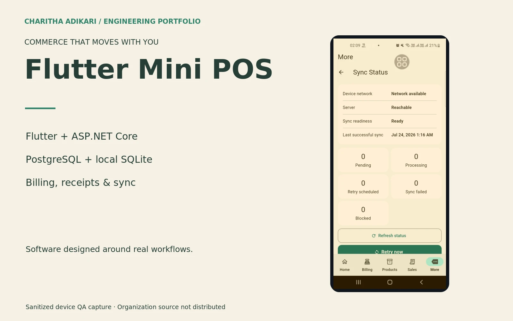

# Flutter Mini POS

Mobile billing and sales workflows backed by ASP.NET Core, with local persistence and explicit synchronization boundaries.

## Engineering

This mobile commerce project is separate from my academic React and Spring Boot POS. The Flutter client integrates with an ASP.NET Core modular backend and PostgreSQL. SQLite supports local persistence and queued synchronization while the server remains authoritative for authorization and financial records. The implementation includes billing services, sale-receipt snapshots, receipt previews and offline-sale handling. This case study presents permitted implementation concepts without publishing organization-owned source or customer information.

## Contribution

Developed Flutter mobile POS and .NET workflows for products, billing, payments and sales history, as documented in my freelance experience.

## Technologies

Flutter · Dart · ASP.NET Core · Entity Framework Core · PostgreSQL · Drift / SQLite

## Implemented capabilities

- Product, billing and sales-history workflows
- Payment handling and receipt snapshots
- Local cache and queued offline-sale synchronization
- Server-side role and tenant boundaries

Public case study. Visual evidence: sanitized device QA capture of the synchronization screen. Organization-owned source remains private.

[Portfolio](https://charithaadikari.vercel.app/projects/105)
