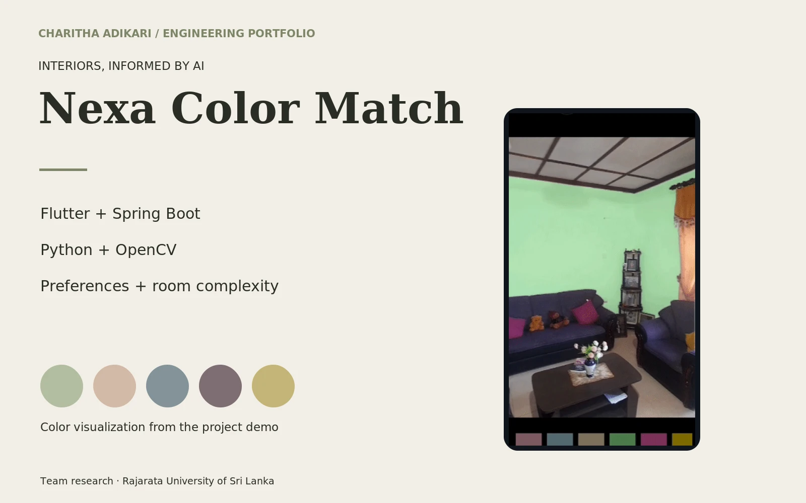

# Nexa Color Match

Personalized interior wall-color exploration, connecting a Flutter experience with Spring Boot APIs and Python image analysis.

## Engineering

Interior color selection needs to account for the room as well as personal preferences. This university team project connects a Flutter application, a Java Spring Boot API and Python image-processing components. The room-complexity implementation measures object area, entropy and visual clutter, then combines those signals through fuzzy logic. The repository also contains image capture, object marking, preference collection and color visualization. Engineering work spans image payloads, API integration and persistence across the application layers.

## Contribution

Academic team contributor to the interior color-matching application. The implementation combines mobile, backend and image-analysis components; individual algorithm ownership is not claimed.

## Technologies

Flutter · Java · Spring Boot · Python · OpenCV · MySQL · AWS S3

## Implemented capabilities

- Interior image capture and polygon-based object marking
- Customer preference collection and color-palette exploration
- Area, entropy and visual-clutter analysis combined with fuzzy logic
- Mobile interface, REST APIs and image-storage integration

Rajarata University of Sri Lanka. Academic team: Thilina Premachandra, Asini Warnasooriya, Charitha Adikari, Isuru Pradeep and Manuwendra Vikum. Research co-author: Dr. K. A. S. H. Kulathilake.

Research: [An AI-Driven Approach for User-Personalized Interior Color Matching Using Room Complexity and Visual Context](https://doi.org/10.1109/SCSE70081.2026.11499927)

Visual evidence: frame from the existing project demonstration. Team research; no sole-authorship claim.

[Portfolio](https://charithaadikari.vercel.app/projects/10)

## Technical article

[How We Built Nexa Color Match: Flutter, Spring Boot, and Python](https://medium.com/@charithabimsara/how-we-built-nexa-color-match-with-flutter-spring-boot-and-python-f1f95de7c8ff)
