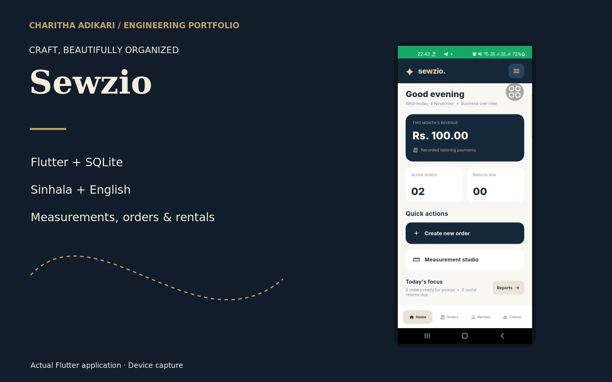

# Sewzio

A Sinhala and English tailoring workspace for customer measurements, garment orders and rental management.

## Engineering

Sewzio brings customer measurements and day-to-day tailoring work into a mobile interface. Reusable garment templates define measurement fields while orders preserve their own measurement snapshots. The order service validates measurements and stores related changes transactionally in SQLite. Workflow stages cover cutting, stitching, quality checks and delivery. Rental entities and services support garments that are hired rather than made to order. The interface includes Sinhala and English presentation.

## Contribution

Developed the Flutter tailoring application and its measurement, order and rental workflows.

## Technologies

Flutter · Dart · SQLite · sqflite

## Implemented capabilities

- Custom measurement fields and reusable garment templates
- Order stages from acceptance through delivery
- Order payments and outstanding amounts
- Rental inventory and booking workflows
- Sinhala and English interface

Visual evidence: existing device capture of the Flutter application. No customer records are shown.

[Portfolio](https://charithaadikari.vercel.app/projects/102)
